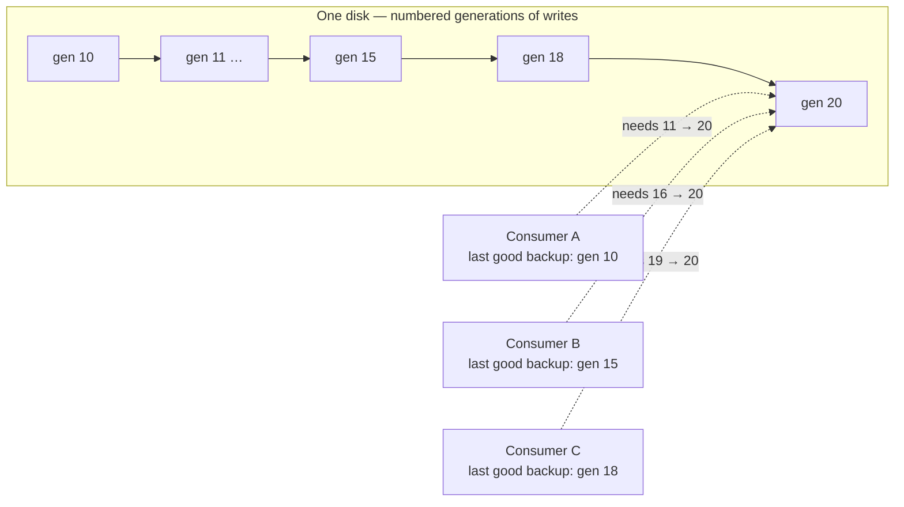
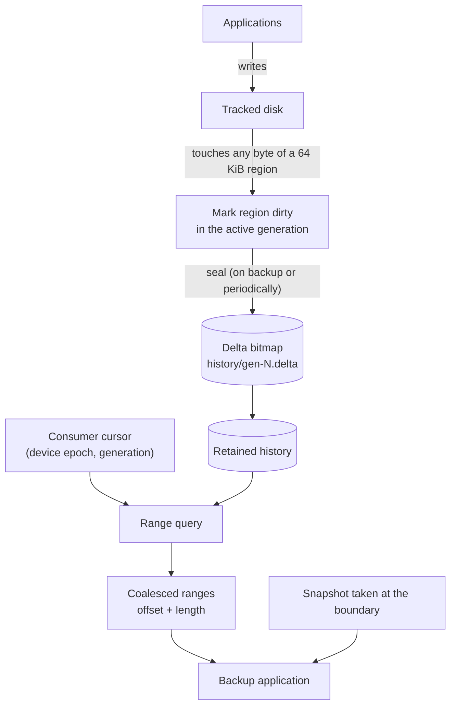
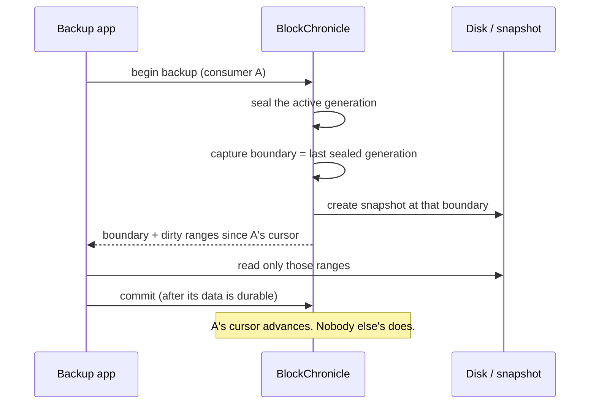

<div align="center">

# BlockChronicle

**A block-level change tracker that remembers what every backup already has.**

[](https://github.com/swadhingoswami/BlockChronicle/actions/workflows/ci.yml)


</div>

---

## The problem, in one paragraph

Backing up a 1 TB disk every night is slow because most of it did not change. The usual
fix is *changed block tracking*: remember which 64 KiB regions were written, and back up
only those. That works until **more than one backup product backs up the same machine**.
Each one has its own schedule and its own last successful backup. A naive tracker keeps a
single "dirty since last backup" bitmap and clears it when *any* backup finishes — silently
destroying the history the other consumers still need.

BlockChronicle keeps a **numbered history of changes** plus an **independent cursor per
consumer**, so one consumer's success can never corrupt another consumer's incremental
chain.

## Why that is harder than it sounds

One disk, three backup products, different schedules:



Consumer C finishes its backup at generation 20. Nothing about that may remove the
history Consumer A needs to resume from generation 10 — even if A has been offline for
a month.

There are three traps, and this project exists to survive all three:

| Trap | What goes wrong | How BlockChronicle handles it |
|---|---|---|
| Shared bitmap | One backup clears it; another consumer gets an incomplete backup that *reports success* | History is immutable per generation; each consumer has its own cursor and pending set |
| Boundary vs. snapshot | Ranges are collected at one moment, data read at another → backup is internally inconsistent | Boundary is captured atomically with the snapshot; a dedicated test proves the ordering |
| Crash | Cursor advances before data is durable, or history is lost after a reboot | Write-ahead log, fsync ordering, and crash tests for 15 failure points |

## How it works



A backup looks like this:



## Quick start

Needs CMake ≥ 3.20 and a C++17 compiler. The core builds on macOS too; only the future
kernel backend is Linux-specific.

```bash
cmake -S . -B build -DCMAKE_BUILD_TYPE=Release
cmake --build build -j
ctest --test-dir build            # 138 tests

./build/blockchronicle device register disk1 --data /tmp/disk1.img --capacity 1073741824
./build/blockchronicle consumer add backup-A --device disk1
./build/blockchronicle backup start --device disk1 --consumer backup-A
```

```text
registered disk1
added consumer backup-A to disk1
a full backup is required before incremental backups

boundary: 1
cursor: 0
kind: full
action: copy the whole device
```

After the consumer has copied the device and recorded that backup:

```bash
./build/blockchronicle backup commit --device disk1 --consumer backup-A \
    --backup-id 1 --boundary 1
./build/blockchronicle backup start --device disk1 --consumer backup-A
```

```text
boundary: 2
cursor: 1
kind: incremental
ranges: 3
  0 65536
  196608 131072
  655360 65536
dirty-bytes: 262144
```

That is the whole idea: 256 KiB to transfer instead of 1 GiB.

## What is actually proven

This project distinguishes "implemented" from "proven". The current evidence:

| Claim | Evidence |
|---|---|
| A write crossing a region boundary marks both regions | `MarkUnalignedCrossBoundaryMarksBothRegions` |
| No mark is lost or duplicated across a seal | `NoMarkLostAcrossConcurrentSeals` + mutation-tested seal protocol |
| A consumer's ranges are exactly `union(cursor, boundary]` | property tests against a naive oracle |
| The derived ranges match the data a consumer would restore | `IncrementalRoundsReconstructTheDeviceExactly` — byte-for-byte over five rounds |
| Crash recovery loses no acknowledged fact | 15 crash points in `tests/recovery/` |
| Two processes cannot corrupt one metadata directory | exclusive `flock`, `SecondOpenIsRefusedWhileTheFirstIsAlive` |
| Every metadata parser survives arbitrary bytes | random, truncated and bit-flipped input under ASan/UBSan |
| Retention never deletes history a consumer needs without invalidating it first | `PolicyThatWouldBreakAConsumerInvalidatesItFirst` |

**Explicitly not proven:** that `fsync` reached the platter. A process crash leaves the
page cache intact, so the crash tests validate *ordering*, not durability. See
[`docs/implementation-status.md`](docs/implementation-status.md).

## Current status

| Phase | Scope | State |
|---|---|---|
| 0 | Architecture review, feasibility, risk register | ✅ |
| 1 | Dirty bitmap + region arithmetic | ✅ |
| 2 | Generation lifecycle and seal protocol | ✅ |
| 3 | Historical bitmap semantics | ✅ |
| 4 | Independent backup consumers | ✅ |
| 5 | Durable metadata, WAL, crash recovery | ✅ |
| 6 | File-backed simulator, multi-device engine, CLI | ✅ |
| 7 | Linux `dm-era` backend | ⛔ blocked on hardware — probe and report templates ready |
| 8 | Hardening: retention, `verify`, logging, config, CI, packaging | ✅ (no daemon yet) |

`138 tests`, run under `RelWithDebInfo`, `ASan+UBSan` and `TSan` in CI.

## Repository layout

```
include/blockchronicle/   public headers (bitmap, generations, history,
                          consumers, persistence, engine, simulator, verify)
src/core/                 tracking logic: bitmap, generations, history, consumers
src/persistence/          CRC32C, codec, superblock, WAL, delta files
src/backend/simulator/    file-backed virtual disk
src/service/              engine, verification, logging, configuration
src/cli/                  the blockchronicle binary
tests/                    unit, concurrency, persistence, recovery, integration
tools/                    benchmark, dm-era probes
docs/                     architecture and operational documentation
packaging/                systemd timer, install notes
```

## Documentation

| Document | What it answers |
|---|---|
| [architecture.md](docs/architecture.md) | Component model, API sketch, the five places the original design was wrong |
| [consistency-model.md](docs/consistency-model.md) | Generations, boundaries, and the proof that a backup cannot miss a write |
| [bitmap-history.md](docs/bitmap-history.md) | Delta vs. cumulative bitmaps, and why the obvious shortcut loses data |
| [metadata-format.md](docs/metadata-format.md) | On-disk formats, WAL, checkpointing, the 15-row crash matrix |
| [concurrency.md](docs/concurrency.md) | Lock ordering, the mark-vs-seal protocol |
| [linux-backend.md](docs/linux-backend.md) | `dm-era` feasibility, decision criteria for a kernel module |
| [performance.md](docs/performance.md) | Measured numbers, with the caveats that matter |
| [security.md](docs/security.md) | Threat model and known gaps |
| [implementation-status.md](docs/implementation-status.md) | What is done, what is deferred, and why |
| [risks.md](docs/risks.md) | Risk register, including findings that changed the design |

## What this is not

- **Not a backup application.** It produces dirty ranges and a snapshot boundary.
- **Not a snapshot implementation.** It coordinates with `dm-snapshot`/`dm-thin`; the
  built-in file-backed snapshot is a simulator convenience.
- **Not application-consistent.** Even with a perfect block snapshot you get
  crash-consistency only; filesystem or application quiescing is the caller's job.
- **Not production-ready.** No daemon, no `flock` guard, no authenticated API.

## License

Apache-2.0 — see [LICENSE](LICENSE) and [NOTICE](NOTICE).
