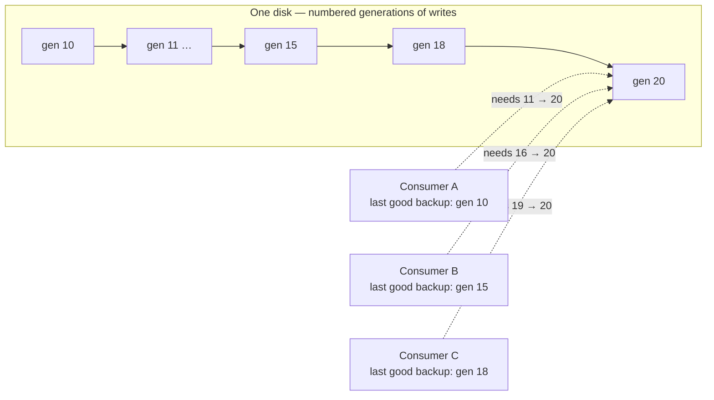
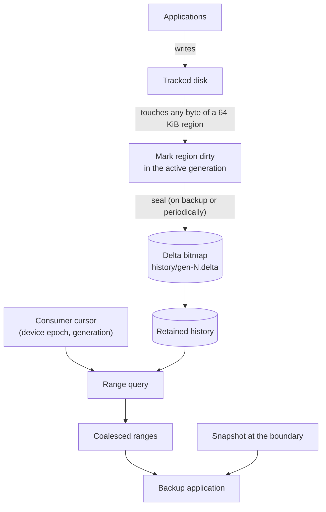
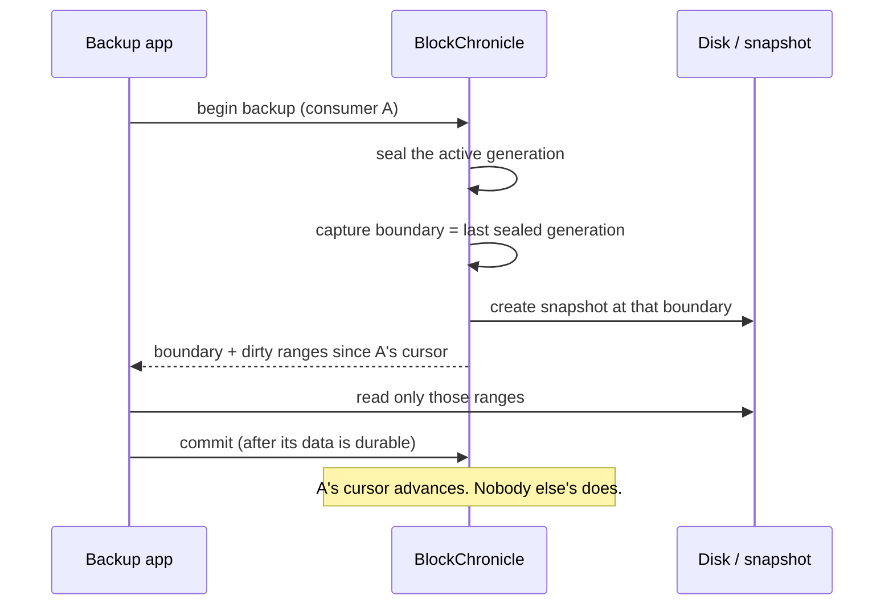

<div align="center">

# BlockChronicle

**Back up what changed, not what didn't — and never break another backup's history.**

[](https://github.com/swadhingoswami/BlockChronicle/actions/workflows/ci.yml)


</div>

---

## What is this, in one minute

Imagine a 1 TB disk. You back it up nightly. Almost nothing changes between nights, so
copying all 1 TB again is wasteful. BlockChronicle records **which 64 KiB regions of the
disk were written**, so the next backup only has to copy those.

The hard part is not the bitmap. It is that **several backup products may back up the same
machine**, each on its own schedule. Each one remembers a different "last time". Clearing a
shared bitmap when one of them finishes would silently break the others.

BlockChronicle keeps a numbered history of changes and an independent cursor per backup,
so one consumer's success cannot damage another's chain.

## The problem, drawn



C finishes a backup at generation 20. Nothing about that may remove the history A needs to
resume from generation 10.

---

## Use it

### What you need

- Linux or macOS (the core is portable; only a future kernel backend is Linux-only)
- CMake 3.20 or newer
- A C++17 compiler (GCC 11+, Clang 14+)
- No root, no device mapper, no kernel module

### Step 1 — get the code and build

```bash
git clone https://github.com/swadhingoswami/BlockChronicle.git
cd BlockChronicle
cmake -S . -B build -DCMAKE_BUILD_TYPE=Release
cmake --build build -j
```

You should end with `Built target blockchronicle` and three test binaries.

### Step 2 — run the built-in demo (30 seconds, nothing to set up)

```bash
./build/bc_example_backup
```

```text
BlockChronicle demo — incremental backup of a 1024 KiB virtual disk

[1/7] Create a virtual disk with 16 trackable regions (64 KiB each)
       data file:     /tmp/blockchronicle-demo-93072/disk.img
       metadata dir:  /tmp/blockchronicle-demo-93072/meta

[2/7] Write 192 KiB: three regions filled with a known pattern
       regions 0, 1, 2 now hold data

[3/7] Full backup for consumer backup-A
       kind:      full (a new consumer must copy everything first)
       boundary:  generation 1
       the consumer now holds the whole disk

[4/7] Change two regions (this is what a normal day looks like)
       region  5 changed
       region 11 changed

[5/7] Incremental backup for backup-A
       kind: incremental
       dirty ranges: 2
         offset   327680  length  65536
         offset   720896  length  65536

[6/7] Restore check: compare the consumer's copy with the real disk
       MATCH — every byte of the backup equals the disk

[7/7] What this saved
       full backup size:         1048576 bytes
       incremental transfer:      131072 bytes
       reduction:                    88%
```

That is the whole product: the second backup moved 128 KiB instead of 1 MiB, and the
restored copy is byte-for-byte identical.

### Step 3 — run the tests

```bash
ctest --test-dir build --output-on-failure
```

```text
100% tests passed, 0 tests failed out of 140
```

To run a single suite (each file is one binary):

```bash
./build/tests/bc_workflow_tests            # end-to-end backup and restore
./build/tests/bc_recovery_tests            # crash recovery
./build/tests/bc_concurrency_tests         # threads
./build/tests/bc_unit_tests                # bitmap and history maths
./build/tests/bc_persistence_tests         # file formats and WAL
./build/tests/bc_robustness_tests          # garbage input to every parser
./build/tests/bc_service_tests             # config and logging
./build/tests/bc_consumer_tests            # consumer lifecycles
```

To run **one** test by name:

```bash
./build/tests/bc_workflow_tests --gtest_filter='BackupWorkflow.Incremental*'
```

### Step 4 — use the command line

Every command below is a separate process, so the device is opened and closed each time.
That is deliberate: `flock` guarantees only one process touches a metadata directory.

Use a throwaway directory so nothing touches your home folder:

```bash
export ROOT=/tmp/bc-demo
mkdir -p "$ROOT"
```

**4.1 Register a virtual disk** (1 MiB, so the output stays short):

```bash
./build/blockchronicle --root "$ROOT" device register disk1 \
    --data "$ROOT/disk1.img" --capacity 1048576
```
```text
registered disk1
```

> This creates the data file and a metadata directory holding the history. Running it
> twice for the same id fails with `InvalidState`; use `device list` to see what exists.

**4.2 Add a backup consumer:**

```bash
./build/blockchronicle --root "$ROOT" consumer add backup-A --device disk1
```
```text
added consumer backup-A to disk1
a full backup is required before incremental backups
```

> A new consumer has no history, so it must copy everything once. Only after that
> first backup can it receive incremental ranges.

**4.3 Ask what must be backed up:**

```bash
./build/blockchronicle --root "$ROOT" backup start --device disk1 --consumer backup-A
```
```text
boundary: 1
cursor: 0
kind: full
action: copy the whole device
```

> `boundary: 1` is the point in time you must copy. `kind: full` means: no ranges
> for you yet, copy the whole disk.

**4.4 Tell it the backup finished:**

```bash
./build/blockchronicle --root "$ROOT" backup commit --device disk1 \
    --consumer backup-A --backup-id 1 --boundary 1
```
```text
committed backup-A at generation 1
```

> Only now does `backup-A`'s cursor move. If this step never happens (crash,
> failure, cancellation) the cursor stays where it was and nothing is lost.

**4.5 Change two regions** (this is what an application writing to the disk does):

```bash
./build/blockchronicle --root "$ROOT" device write disk1 --offset 327680 --length 65536 --value 17
./build/blockchronicle --root "$ROOT" device write disk1 --offset 720896 --length 65536 --value 34
```
```text
wrote 65536 bytes at offset 327680
wrote 65536 bytes at offset 720896
```

**4.6 Ask again — this time you get ranges:**

```bash
./build/blockchronicle --root "$ROOT" backup start --device disk1 --consumer backup-A
```
```text
boundary: 3
cursor: 1
kind: incremental
ranges: 2
  327680 65536
  720896 65536
dirty-bytes: 131072
```

> Two ranges, 128 KiB total. The `boundary: 3` happens because each write command
> seals its generation when it exits. `cursor: 1` is where `backup-A` left off.

**4.7 Inspect history directly:**

```bash
./build/blockchronicle --root "$ROOT" bitmap compare --device disk1 --from 1 --to 3
```
```text
dirty-regions: 2
dirty-bytes: 131072
ranges: 2
  327680 65536
  720896 65536
```

**4.8 Check the store is healthy:**

```bash
./build/blockchronicle --root "$ROOT" verify --device disk1
```
```text
superblock: ok
identity: ok
history: complete
journal: clean
torn-tail: no
clean-shutdown: yes
generations-retained: 3
journal-records: 0
consumers: 1
result: healthy
```

`verify` writes nothing. It exits `0` when healthy and `2` when something is wrong, which
makes it usable in a cron job or a monitoring check.

**4.9 See the consumer's state:**

```bash
./build/blockchronicle --root "$ROOT" status --device disk1
./build/blockchronicle --root "$ROOT" consumer list --device disk1
```
```text
device: disk1
capacity: 1048576
granularity: 65536
active-generation: 4
last-sealed: 3
recovery: clean

consumer	cursor	last-backup	state
backup-A	1	1	incremental
```

> `backup-A` can still see generations 2 and 3 whenever it next runs, even though
> this session never committed them. That is the point of the project.

### All commands

```text
device register <id> --data <file> --capacity <bytes>
device list
device write <id> --offset <bytes> --length <bytes> [--value <0-255>]
device remove <id>
consumer add <id> --device <id>
consumer list --device <id>
consumer remove <id> --device <id>
backup start  --device <id> --consumer <id>
backup commit --device <id> --consumer <id> --backup-id <n> --boundary <gen>
snapshot save   --device <id> --generation <g> --label <name>
snapshot list   --device <id>
snapshot delete --device <id> --label <name>
bitmap compare --device <id> --from <gen> --to <gen>
checkpoint [--device <id>]      # default: every device
gc [--device <id>] [--keep-generations <n>]
verify --device <id>
status --device <id>
```

Global options: `--root <dir>` (or `$BLOCKCHRONICLE_ROOT`), `--config <file>`, `--verbose`.

---

## Test cases: what is covered

| Suite | Proves |
|---|---|
| `bc_unit_tests` | Region maths, overflow handling, bitmap operations, coalescing |
| `bc_history_tests` | Union semantics and the property that the derived answer equals the definition |
| `bc_consumer_tests` | Independent cursors; the brief's A/B/C scenario where B succeeds and A fails |
| `bc_persistence_tests` | File formats, checksums, WAL framing, torn tails |
| `bc_robustness_tests` | Random, truncated and bit-flipped input to every parser |
| `bc_recovery_tests` | 16 crash points, retention, `verify`, single-writer lock |
| `bc_concurrency_tests` | Marks vs. seals under threads (run under TSan in CI) |
| `bc_workflow_tests` | **End-to-end: restore equals the disk, byte for byte** |

Run everything under AddressSanitizer and UndefinedBehaviorSanitizer:

```bash
cmake -S . -B build-asan -DCMAKE_BUILD_TYPE=Debug -DBC_SANITIZE=address,undefined
cmake --build build-asan -j
ctest --test-dir build-asan --output-on-failure
```

Run the concurrency suite under ThreadSanitizer:

```bash
cmake -S . -B build-tsan -DCMAKE_BUILD_TYPE=Debug -DBC_SANITIZE=thread
cmake --build build-tsan -j
ctest --test-dir build-tsan --output-on-failure
```

CI runs all of the above on every push: GCC, Clang, macOS, three sanitizers, and a job
that fails the build on any compiler warning.

---

## Working on a change

`main` is always green. Do not commit to it directly.

```bash
git checkout main
git pull
git checkout -b feature/short-description

# ... make your change ...

cmake --build build -j
ctest --test-dir build --output-on-failure   # must be 140/140

git add -A
git commit -m "short description of what and why"
git push -u origin feature/short-description
```

Then open a pull request against `main`. CI must pass before merging. If you change a
file format, add a test that fails without your change and update
`docs/implementation-status.md`.

---

## How it works





## What is proven, and what is not

| Claim | Evidence |
|---|---|
| A write crossing a region boundary marks both regions | `MarkUnalignedCrossBoundaryMarksBothRegions` |
| No mark is lost or duplicated across a seal | `NoMarkLostAcrossConcurrentSeals` |
| Ranges are exactly `union(cursor, boundary]` | property tests against a naive oracle |
| The ranges match the data a consumer would restore | `IncrementalRoundsReconstructTheDeviceExactly` |
| Crash recovery loses no acknowledged fact | the crash matrix in `tests/recovery/` |
| Two processes cannot corrupt one metadata directory | `flock` + `SecondOpenIsRefusedWhileTheFirstIsAlive` |
| Every metadata parser survives arbitrary bytes | random, truncated and bit-flipped input under ASan/UBSan |

**Not proven:** that `fsync` reached the platter. A process crash leaves the page cache
intact, so the crash tests validate ordering, not hardware durability. That needs
power-cut testing on real hardware.

**Not implemented:** the Linux `dm-era` backend. The probe and measurement scripts are in
`tools/dm-era/`; the report is blank by design until somebody runs them on a Linux host.

## Status

| Phase | Scope | State |
|---|---|---|
| 0–6 | Design, bitmap, generations, history, consumers, persistence, simulator, CLI | ✅ |
| 7 | Linux `dm-era` backend | ⛔ blocked on hardware |
| 8 | Retention, `verify`, logging, config, CI, packaging | ✅ (no daemon yet) |

## Repository layout

```
include/blockchronicle/   public headers
src/core/                 bitmap, generations, history, consumers
src/persistence/          CRC32C, codec, superblock, WAL, delta files
src/backend/simulator/    file-backed virtual disk
src/service/              engine, verification, logging, config
src/cli/                  the blockchronicle binary
examples/                 runnable demo (bc_example_backup)
tests/                    unit, concurrency, persistence, recovery, integration
tools/                    benchmark, dm-era probes
docs/                     architecture and operations
packaging/                systemd timer, install notes
```

## Documentation

| Document | Answers |
|---|---|
| [architecture.md](docs/architecture.md) | Component model and the five places the original design was wrong |
| [consistency-model.md](docs/consistency-model.md) | Why a backup cannot miss a write (with proof) |
| [bitmap-history.md](docs/bitmap-history.md) | Delta vs. cumulative bitmaps, and the shortcut that loses data |
| [metadata-format.md](docs/metadata-format.md) | On-disk formats, WAL, crash matrix |
| [concurrency.md](docs/concurrency.md) | Lock ordering and the mark-vs-seal protocol |
| [linux-backend.md](docs/linux-backend.md) | `dm-era` feasibility and decision criteria |
| [performance.md](docs/performance.md) | Measured numbers, with caveats |
| [security.md](docs/security.md) | Threat model and known gaps |
| [implementation-status.md](docs/implementation-status.md) | What is done, deferred, and why |

## What this is not

- **Not a backup application.** It produces dirty ranges and a snapshot boundary.
- **Not a snapshot implementation.** It coordinates with `dm-snapshot`/`dm-thin`.
- **Not application-consistent.** Block-level only; quiescing is the caller's job.
- **Not production-ready.** No daemon, no authenticated API.

## License

Apache-2.0 — see [LICENSE](LICENSE) and [NOTICE](NOTICE).
