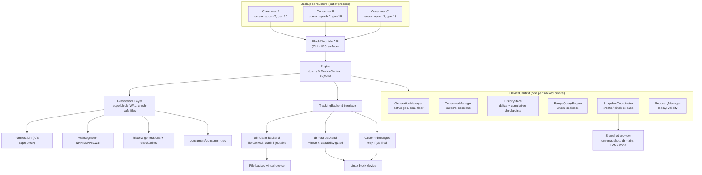
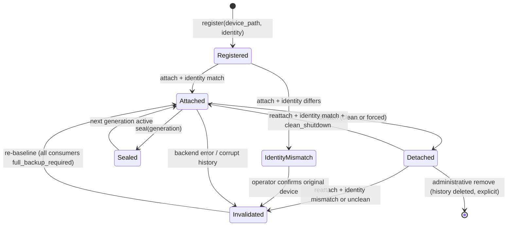

# BlockChronicle — Architecture Review

**Document status:** Phase 0 deliverable. Reviewed design, not implemented design.
**Audience:** project owner; assumes strong C++/Linux/storage background.

---

## 1. Product specification (concise)

BlockChronicle is a Linux service plus library that:

1. **Observes** writes to one or more block devices at a fixed granularity (v1: 64 KiB).
2. **Records** each observation durably, attributed to a monotonic **generation**.
3. **Preserves** per-generation history so that a *union of deltas* over an arbitrary
   interval can be computed later, possibly after reboot.
4. **Tracks** N independent **consumers**, each holding its own committed cursor
   `(device_epoch, generation)`.
5. **Answers** range queries for a consumer: coalesced `(offset, length)` lists covering
   every region changed since that consumer's cursor, up to a **boundary** that is tied
   to a **snapshot** of the data.
6. **Refuses** to answer — returning "full backup required" instead — whenever it cannot
   prove the answer is complete.

The engine never reads or stores user data. It is a change catalogue plus a consistency
coordinator, nothing more.

### What BlockChronicle is not

- It is not a backup application. It produces *dirty range lists* and *snapshot handles*.
- It is not a snapshot implementation. It coordinates with one (`dm-snapshot`, `dm-thin`,
  LVM, or zfs/btrfs snapshots through an adapter), or it runs without one and reports
  reduced guarantees.
- It is not a filesystem-consistent or application-consistent backup tool.

---

## 2. Five corrections to the proposed design

The brief is unusually well specified. The following points are where I believe the
current design is either under-specified in a way that will produce silent data loss, or
outright incorrect. These are the review's most important content.

### C1. "One frozen generation per device" conflicts with the multi-consumer goal

The brief says: *support one frozen backup boundary per device initially.* That is a
reasonable simplification for snapshot/CBT mechanics, but as stated it implies the
device-level state machine contains a single frozen bitmap that the next backup
consumes. With ten consumers and independent schedules, that design forces serialized
backups and, worse, invites the classic bug of clearing the frozen bitmap when *any*
consumer commits.

**Correction:** there is no per-consumer frozen state at all.

- **Generations are device-wide and monotonic.** A generation is a numbered interval of
  writes. Sealing a generation is a device-level operation.
- **A consumer's requirement is a set of generations**, `(cursor, boundary]`, not a
  bitmap.
- **Bitmaps are immutable once sealed.** Nothing is ever "cleared" when a consumer
  commits. Retention is decided by `min(cursor)` across consumers plus in-flight
  sessions, and by nothing else.

The word "frozen" should be reserved for the *read point* of a snapshot, which is a
different resource with a different lifetime (see C2). Removing the per-device frozen
bitmap removes an entire class of bugs.

### C2. Generation rotation and snapshot creation are conflated

The brief lists: *establish a tracking boundary → establish a consistent snapshot*,
and asks for the ordering to be designed and proven. The ordering is the hard part and
the brief's hand-wavy "safe snapshot boundary" must be replaced by a precise rule.

**The rule (proved in [consistency-model.md](consistency-model.md) §4):**

> The boundary generation assigned to a backup session is **the generation that was
> active at the instant the snapshot was created**. Generations advance only at
> explicit, serialized seal points, and a seal point is never concurrent with snapshot
> creation.

Consequences:

- Writes that land between "seal" and "snapshot created" are attributed to the *new*
  generation while their data **is** present in the snapshot. Reporting them is a false
  positive, which is safe.
- The reverse order (snapshot taken at generation `G`, session boundary recorded as
  `G-1`) is a **silent data loss bug**: a write in `G` before the snapshot would be
  reported in a later interval and its data would not be in the earlier snapshot's
  backup set. This is the single most likely serious bug in the whole system, and it is
  easy to write.

Therefore rotation must never be inferred from timestamps or from "when the backup
started". It is captured by the snapshot creation call itself, under the device lock.

### C3. A durable WAL record per write is unaffordable and unnecessary

The proposal (`WRITE_DIRTY` journal record per write) is correct for the *simulator's*
durability model but is not a viable production design: at 64 KiB granularity, one
`fsync` per write group costs 3–4 orders of magnitude of throughput, and the journal
record can be larger than the data written.

**Correction: split the two roles.**

- **Near-term dirty state lives below userspace** — in the kernel target, or in the
  simulator's in-memory ring. Its durability contract is stated explicitly, not assumed.
- **The userspace WAL records only control-plane events**: `SEAL`, `CONSUMER_COMMIT`,
  `INVALIDATE`, `SNAPSHOT_*`, `GC_PLAN/GC_DONE`, `CHECKPOINT`, plus (in the simulator
  only) aggregated `MARK_RANGE` records used by crash tests.
- Data-plane durability is achieved by **sealing**: on seal, the delta bitmap of the
  closing generation is flushed to the metadata store *before* the seal is acknowledged
  and *before* any backup session may reference that generation.

This changes the failure mode from "per-write loss" to "loss of the unsealed tail", which
is handled by the `clean_shutdown` token and the invalidation rule (C4). Bitmap history
is bounded in size and cheap to fsync once per generation, not once per write.

### C4. Power-loss exactness cannot be guaranteed; make invalidation the default, not the exception

The brief hopes for a protocol where "a crash after step 2 but before step 4 may cause a
false positive. That is acceptable." That is achievable in the simulator, and it is
**not** achievable in the kernel path without a metadata flush ordered before every
data write (FUA/`REQ_PREFLUSH` per write group), which destroys write throughput.

**Correction:** v1 must adopt an explicit, durable, monotonic `tracking_epoch` with a
`clean_shutdown` flag:

- Clean shutdown → bump epoch, keep history, continue incrementally.
- Unclean shutdown (power loss, SIGKILL, kernel panic, metadata device error) → on
  recovery, **invalidate tracking for the affected device**: persist
  `tracking_valid = false`, mark every consumer `full_backup_required = true`, require a
  re-baseline before incremental service resumes.

This is a deliberate trade: correctness is proven in exchange for a full backup after
unclean shutdown. The alternative (optimistic resume) is exactly the "silent incomplete
incremental" failure the brief forbids. If the kernel backend later demonstrates an
ordered metadata-first write path, the policy can be weakened *per backend, per
capability*, with a recorded and tested capability flag — never silently.

### C5. Dense per-generation bitmap files scale badly; history depth is the real constraint

At 64 KiB granularity a 1 TiB device is 16.78 M regions → **2 MiB per dense bitmap**.
`max_history_generations = 1000` therefore means **2 GiB of metadata** for *one* device,
ignoring journal and index overhead. A 10 TB device is 18 MiB × 1000 = **18 GiB**.

**Correction:** three-part answer, applied in this order:

1. **Store deltas, not cumulative states, as the authoritative history.** Deltas cover
   only what actually changed since the last seal; on a quiet device they are nearly
   empty. Cumulative states are *derived analysis structures* kept every `K`
   generations (recommended `K = 16`) and rebuildable from deltas. They must not be used
   to compute incremental ranges (§6, "Delta, cumulative, or both?").
2. **Encode deltas sparsely**: presence bitmap over 64-bit words plus packed nonzero
   words, or range/RLE encoding. Dense layout remains as format flag `0` for Phase 1
   simplicity.
3. **Make retention a function of bytes, not just generations.** `max_history_bytes` and
   `max_history_generations` both apply; the effective limit is the tighter one.

The same math applies to `dm-era`, where it is fatal (see [linux-backend.md](linux-backend.md) §3).

---

## 3. System architecture



### What each component exists for

| Component | Problem it solves | Fails how |
|---|---|---|
| `Engine` | Process-wide registry, one `DeviceContext` per device, no global lock on the data path | Refuses to start if registry is corrupt |
| `DeviceContext` | Isolation: per-device lock, per-device history, per-device backend | One bad device cannot wedge others |
| `GenerationManager` | Converts a continuous write stream into numbered, immutable intervals so unions are computable | Seal fails → no new boundary; tracking continues into same generation |
| `ConsumerManager` | Independent cursors, sessions, full-backup flags | Corruption → that consumer is invalidated, others unaffected |
| `HistoryStore` | Durable, verifiable per-generation deltas + acceleration checkpoints | Checksum failure → consumers depending on that range invalidated |
| `RangeQueryEngine` | Converts bitmaps into coalesced byte ranges without materializing block lists | Pure function over validated bitmaps; no failure mode |
| `SnapshotCoordinator` | Binds a read point to a generation; owns snapshot lifetime | No provider → session is marked `no_snapshot` and the API reports reduced guarantee |
| `RecoveryManager` | Deterministic replay, validity decision, quarantine | Cannot prove completeness → invalidation |
| `Persistence Layer` | Explicit LE serialization, CRC32C, A/B superblock, fsync discipline | Refuses to open on format mismatch |
| `TrackingBackend` | Makes the kernel/simulator swap honest and capability-reported | Unsupported capability → tracking unsupported, never guessed |

### Responsibility split (this is the crux)

| Concerns | Owner |
|---|---|
| Per-64 KiB dirty bit for the **current** generation | Kernel target or simulator ring (bounded, fast) |
| Sealing a generation, flushing its delta | Userspace (must be durable before the seal is exposed) |
| Long-term deltas, cumulative checkpoints, retention | Userspace only (unbounded, compressible, query-oriented) |
| Consumer cursors, sessions, full-backup flags | Userspace only |
| Snapshot creation and lifetime | Snapshot provider, orchestrated by userspace |
| Crash validity decision | Userspace recovery, based on backend-reported capability + `clean_shutdown` |

The kernel must never own long-term history. It owns a **bounded ring of deltas plus a
durable seal marker**; userspace drains it. This is the only split that makes kernel
memory bounded and userspace history unbounded in a controlled way.

### Device lifecycle



Rules encoded by the diagram:

- Detach never deletes history.
- Reattach requires identity match **and** a proven-uninterrupted interval. A userspace
  engine can essentially never prove the latter after physical detach, so reattach after
  detach normally lands in `Invalidated`. Note this honestly in the UI.
- `Invalidated` is recoverable only through an explicit re-baseline.

### Initial API sketch

Signatures are the contract; bodies are Phase 1+.

```cpp
// include/blockchronicle/types.h
namespace bc {

using Generation = std::uint64_t;
using ConsumerId = std::string;
using BackupId   = std::uint64_t;

enum class Status { Ok, NotFound, InvalidState, OutOfRange, Corrupt, Unsupported };

struct DeviceEpoch {                 // identities that must never be confused
    std::uint64_t   epoch;           // bumped on every re-baseline / invalidation
    MetadataUuid    metadataUuid;    // random, created with the device directory
};

struct DeviceInfo {
    DeviceUuid      deviceUuid;      // stable identity (see §5)
    std::uint64_t   capacityBytes;
    std::uint32_t   granularityBytes; // 65536 in v1
    std::uint32_t   regionCount;      // ceil(capacity / granularity) - overflow-checked
    std::uint32_t   logicalSectorSize;
    std::uint32_t   physicalSectorSize;
};

struct DirtyRange { std::uint64_t offset; std::uint64_t length; };

struct ConsumerStatus {
    BackupId    lastBackupId;
    Generation  cursorGeneration;
    DeviceEpoch cursorEpoch;         // mismatch => full backup
    bool        fullBackupRequired;
    std::optional<Generation> openSessionBoundary;
};

} // namespace bc
```

```cpp
// include/blockchronicle/backend.h
namespace bc {

struct BackendCapabilities {
    bool reports_current_delta;   // can read the active generation's dirty set
    bool supports_seal;           // can atomically close a generation
    bool durable_before_ack;      // dirty bit durable before write completion
    bool survives_unclean_power;  // may be resumed without invalidation
};

class TrackingBackend {
public:
    virtual ~TrackingBackend() = default;

    virtual const BackendCapabilities& capabilities() const = 0;

    // Called by the data path owner; simulator may implement as a no-op.
    virtual Status markRange(std::uint64_t offset, std::uint64_t length) = 0;

    // Close the active generation and make its delta retrievable.
    virtual Status seal(Generation closingGeneration) = 0;

    // Copy the generation's delta into `out`. Must not require the device to be idle.
    virtual Status readDelta(Generation gen, DirtyBitmap& out) = 0;
};

} // namespace bc
```

```cpp
// include/blockchronicle/engine.h
namespace bc {

class Engine {
public:
    Status registerDevice(const DeviceIdentity&, const DeviceInfo&);
    Status attachDevice(const DeviceUuid&);
    Status detachDevice(const DeviceUuid&, bool clean);

    Status addConsumer(const DeviceUuid&, const ConsumerId&);
    Status removeConsumer(const DeviceUuid&, const ConsumerId&);   // refuses if history pinned? no: marks freed

    // Starts a session. Creates the snapshot and records the boundary atomically
    // with respect to seals. Returns the boundary the consumer WILL cover.
    Status beginBackup(const DeviceUuid&, const ConsumerId&, BackupSession& out);

    Status getDirtyRanges(const BackupSession&, RangeSet& out);     // union over (cursor, boundary]

    Status commitBackup(const BackupSession&, BackupId newBackupId); // durable, then visible
    Status abortBackup(const BackupSession&);

    Status consumerStatus(const DeviceUuid&, const ConsumerId&, ConsumerStatus& out) const;

    Status compareGenerations(const DeviceUuid&, Generation from, Generation to, BitmapDiff& out);

    Status saveSnapshot(const DeviceUuid&, Generation, const std::string& label); // analysis only
    Status listSnapshots(const DeviceUuid&, std::vector<SnapshotMeta>& out) const;
    Status deleteSnapshot(const DeviceUuid&, const std::string& label);  // never touches history
};

} // namespace bc
```

Design notes on the API:

- `beginBackup` is the only place a snapshot and a boundary are created, and both happen
  under the device lock. There is no `setBoundary` setter to misuse.
- `commitBackup` takes a `BackupId` supplied by the consumer's own durable record. The
  engine does not invent backup IDs; it only checks monotonicity per consumer.
- `getDirtyRanges` is a pure read of immutable bitmaps; it can run concurrently with
  writes and with other consumers.
- `abortBackup` must not advance anything. Its only effect is releasing the snapshot and
  the history floor.

### Failure ladder (what the API reports when things degrade)

| Condition | Reported result |
|---|---|
| Consumer cursor epoch ≠ device epoch | `full_backup_required` |
| Oldest retained generation > consumer cursor | `full_backup_required` (persisted *before* the delete) |
| No snapshot provider available | ranges returned, `session.consistency = none` |
| Backend cannot seal | `tracking_unsupported`; no ranges ever returned |
| History checksum failure in required interval | affected consumers → `full_backup_required` |
| Superblock unreadable for a device | device quarantined, all consumers → `full_backup_required` |

There is no path that returns "probably complete" ranges.

---

## 4. Repository structure (initial commit)

Only what exists at Phase 0/1. Empty scaffolding directories are intentionally absent.

```text
BlockChronicle/
├── CMakeLists.txt
├── README.md
├── .gitignore
├── docs/
│   ├── architecture.md
│   ├── consistency-model.md
│   ├── bitmap-history.md
│   ├── metadata-format.md
│   ├── concurrency.md
│   ├── linux-backend.md
│   ├── risks.md
│   └── roadmap.md
├── include/blockchronicle/
│   ├── types.h
│   ├── bitmap.h
│   ├── device.h
│   └── backend.h
├── src/core/
├── src/persistence/
└── tests/unit/
```

Later phases add `src/consumers/`, `src/history/`, `src/recovery/`, `src/snapshot/`,
`src/backend/simulator/`, `src/backend/linux/dm_era/`, `src/cli/`, `kernel/`,
`tests/{integration,concurrency,persistence,recovery,crash}/`, `examples/`.
Each directory is added by the commit that first puts a file in it.

---

## 5. Device identity

Requirements: survive reboot, survive device renumbering, detect substitution, detect
metadata rollback.

Three-layer identity:

1. **Stable device identity** — `ID_WWN` (`/dev/disk/by-id/wwn-0x...`) preferred;
   fall back to `ID_SERIAL` composed of vendor/model/serial; last resort
   `ID_FS_UUID` is **rejected** for whole-disk tracking (it identifies a filesystem, not
   a device, and changes on reformat).
2. **Device epoch pin** — a BlockChronicle-owned 16-byte UUID written into the metadata
   *area the backend controls* (dm-era metadata device, or the simulator's sidecar file),
   together with `device_uuid` and `capacity`. On attach, all three must match. This
   catches the case where two devices carry the same WWID (cloned LUNs, multipath
   misconfiguration) and the case where a device was re-partitioned or resized.
3. **Consumer cursor epoch** — each consumer stores `(device_epoch, generation)`. If the
   engine re-baselines, `device_epoch` increments and every consumer with the old value
   is automatically `full_backup_required`, with no scanning and no ambiguity.

Capacity changes are treated as identity mismatch. A grown device could in principle be
tracked by extending bitmaps, but a shrunk device cannot; do not implement the
distinction in v1 — invalidate.

---

## 6. Answers to the specific questions

**Can `dm-era` provide the historical information needed for independent consumers?**
Partially. It stores per-era write sets persistently, so history exists. It has no
userspace query path for "changes in eras 11..20 unioned"; you take a metadata snapshot
and parse it offline, era by era. And its metadata grows as
`O(eras × regions)`, which is 2 GiB per 1000 eras at 64 KiB granularity on 1 TiB. So:
usable for shallow history and as a PoC, not viable as the history store for the stated
retention targets. Details and the verification checklist in
[linux-backend.md](linux-backend.md).

**Can old and new states be compared reliably after reboot?**
Yes — comparison is a pure function and is not the risky part. *Validity* is. Each
persisted delta must carry device UUID, metadata UUID, granularity, region count,
generation, generation hash chain link, and CRC32C; loading validates all of it and
requires an unbroken chain from the oldest retained generation. If the chain is broken,
the affected interval is invalid regardless of individual checksums passing.

**Delta, cumulative, or both?**
Both, with asymmetric roles — and one correction found during Phase 3. Deltas are
authoritative: the unit of retention, replay and GC. Cumulative bitmaps are derived and
**analysis-only**: they answer "has this region ever changed since the baseline", never
"changed since generation C". Computing `Cum_B AND NOT Cum_C` and calling it the
incremental set is a silent data-loss bug, because it drops every region that changed on
both sides of the cursor. See [bitmap-history.md](bitmap-history.md) §3.1.
The exact acceleration is a per-consumer pending bitmap, OR-ed at each seal and cleared at
commit (Phase 4).

**Retention when one consumer is far behind?**
The floor is `min(cursor_generation)` across all consumers with no explicit exemption,
plus the boundary of any open session. Nothing else may raise it. If configured limits
would cross the floor, the engine first performs a **GC intent commit**
(`GC_PLAN` → invalidate affected consumers → `GC_DONE` → delete bytes). A consumer that
disappears for months costs history, not correctness — it costs a full backup.

**How to coordinate boundaries and snapshots?**
The boundary is the active generation at snapshot creation time, captured atomically in
`beginBackup`. Proof and required preconditions in
[consistency-model.md](consistency-model.md) §4.

**Correct write durability protocol?**
Three layers with distinct contracts: data-plane dirty bits (backend, best-effort with
explicit capability flags), seal (userspace, strictly durable before exposure), control
plane (WAL, strictly durable before ack). Unclean shutdown without a proven capability
⇒ invalidation. See [consistency-model.md](consistency-model.md) §6.

**How to avoid losing tracking during concurrent writes?**
Sealing takes the device's exclusive lock; marking takes the shared lock. A mark in
flight either completes in the old generation or begins in the new one — never straddles
(§3 of [concurrency.md](concurrency.md)). Sealed bitmaps are `shared_ptr<const Bitmap>`
and are never mutated.

**When is a custom DM target justified?**
When (a) required granularity × required history depth exceeds `dm-era`'s metadata
growth budget, (b) offline metadata-snapshot parsing cannot meet query latency, or
(c) `dm-era` proves unable to bound its era array. Criteria and design sketch in
[linux-backend.md](linux-backend.md) §5.

**Behavior on corrupt historical metadata?**
Deterministic degradation, never repair: quarantine the *narrowest* unit that failed
(single delta → consumers whose interval covers it; device superblock → whole device),
persist the invalidation, and report `full_backup_required`. Optional analysis snapshots
that fail validation are dropped with a warning and never affect consumers.

---

## 7. Document map for the remaining deliverables

| Deliverable | Location |
|---|---|
| Detailed historical bitmap model (6) | [bitmap-history.md](bitmap-history.md) |
| Generation lifecycle model (7) | [consistency-model.md](consistency-model.md) §2–§3 |
| Persistent metadata design (8) | [metadata-format.md](metadata-format.md) §2 |
| WAL + crash recovery protocol (9) | [metadata-format.md](metadata-format.md) §4–§6 |
| Thread-safety and locking (10) | [concurrency.md](concurrency.md) |
| `dm-era` feasibility (11) + fallback (12) | [linux-backend.md](linux-backend.md) |
| Unresolved risks (13) | [risks.md](risks.md) |
| Phased plan with acceptance criteria (14) | [roadmap.md](roadmap.md) |
| Repository structure (15) | §4 above |
| Sequence diagrams (4) (5) | [consistency-model.md](consistency-model.md) §7–§8 |
