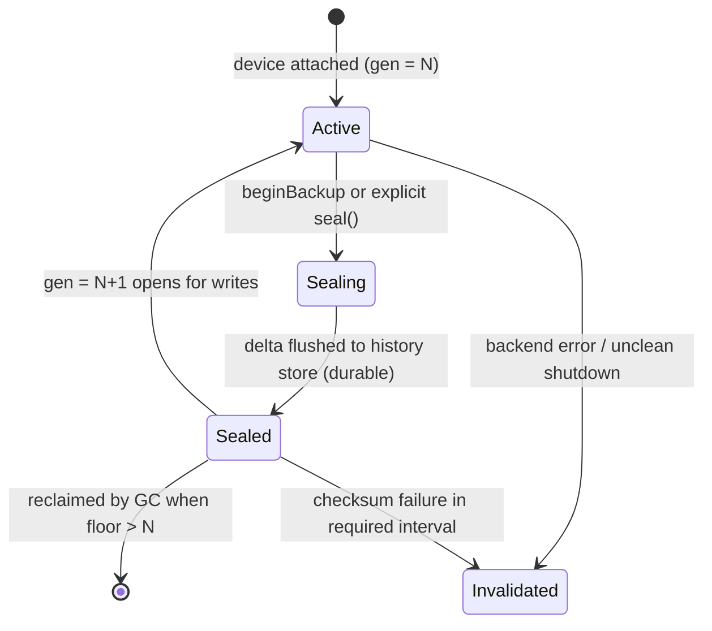
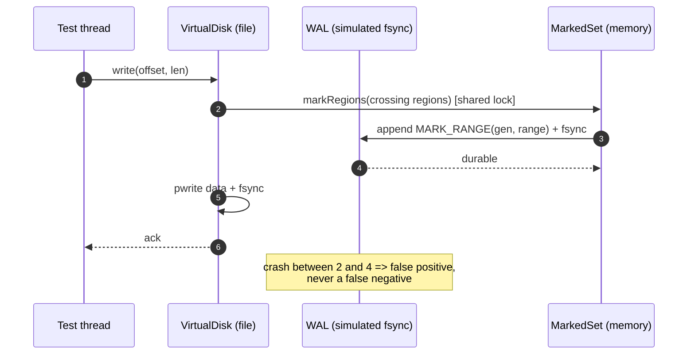
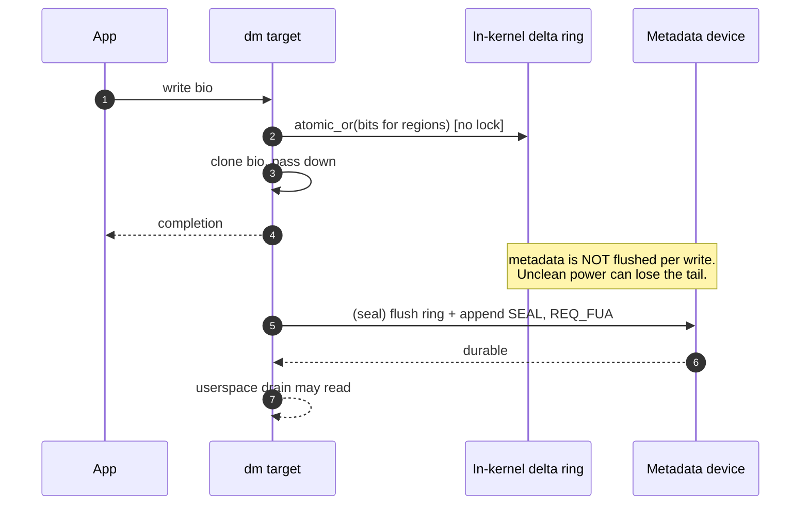

# Consistency Model — Generations, Boundaries, Snapshots, Durability

This document defines the object model that everything else depends on. If it is wrong,
no amount of testing saves the project.

---

## 1. Terms

| Term | Definition |
|---|---|
| **Region** | A fixed-size tracking unit. v1: 64 KiB. Region `i` covers `[i·G, (i+1)·G)`, the last one truncated to capacity. |
| **Generation** | A monotonic integer labelling an interval of writes, starting at 1 per `device_epoch`. `gen` is device-wide, not per consumer. |
| **Delta** | `D_g`: the set of regions written during generation `g` only. Immutable once sealed. |
| **Sealed** | `D_g` is durable and immutable. Only sealed generations are visible to backup sessions. |
| **Active generation** | The generation currently collecting writes. Always exactly one. |
| **Boundary** | The generation associated with a snapshot read point for one backup session. |
| **Session** | A consumer's open backup operation: `(consumer, snapshot, boundary, cursor_at_start)`. |
| **Cursor** | `(device_epoch, generation)` of a consumer's last **successfully committed** backup. |
| **Floor** | Lowest generation that must be retained: `min(cursor) - 1` style boundary derived from all consumers and open sessions. |
| **device_epoch** | Counter bumped on re-baseline/invalidation. Any cursor with a stale epoch is meaningless. |

Sanity note on IDs: `Generation` is device-wide tracking time. `BackupId` is
per-consumer backup sequence. They are unrelated; storing one where the other belongs
must be impossible by type. Use distinct strong typedefs, not `uint64_t` everywhere.

---

## 2. Generation lifecycle



Invariants:

- **I1.** At most one generation is `Active` per device.
- **I2.** A generation number is never reused within a `device_epoch`.
- **I3.** `Sealed` implies the delta is durable and its hash chain link is written.
- **I4.** Writes never land in a `Sealed` generation.
- **I5.** A backup session's boundary is always `Sealed` before `getDirtyRanges` is
  allowed to return.

### When does a seal happen?

Two triggers:

1. **Explicit** — `beginBackup` seals the active generation to create a boundary.
2. **Periodic** — a configurable interval (time or dirty-region count) so that the
   delta between history checkpoints stays bounded. Without this, a device that is
   backed up rarely produces one enormous delta and the history store makes no progress.

Seal cost: serialize one bitmap, fsync, append a `SEAL` record. This is proportional to
bitmap size (2 MiB at 1 TiB) and happens at most a few times per backup cycle, not per
write.

### Union semantics

For consumer `c` with cursor `C` and boundary `B` (`C ≤ B`):

```
Required(c) = OR over g in (C, B] of D_g
```

Equivalently, with a cumulative checkpoint `Cum_k` defined as `OR` of all `D_g` for
`g ≤ k` from the baseline of epoch `E`:

```
Required(c) = Cum_B AND NOT Cum_C            (when checkpoints at exactly C and B exist)
            = Cum_at(floor_ckpt ≤ C) AND NOT ...   (otherwise, replay the leftover tail)
```

The delta form is the definition; the cumulative form is an optimization. See
[bitmap-history.md](bitmap-history.md) §3.

### Why not a single "cumulative per consumer" bitmap?

It would require `O(consumers × regions)` memory (10 × 2 MiB = 20 MiB, tolerable) but it
does not remove the need for deltas: GC, per-generation comparison, and the audit trail
all need `D_g`. Two structures that must agree are worse than one source of truth plus a
cache. Cache it only if measurement demands it.

---

## 3. Multi-consumer model

```mermaid
sequenceDiagram
    autonumber
    participant A as Consumer A (cursor gen 10)
    participant B as Consumer B (cursor gen 15)
    participant E as Engine / DeviceContext
    participant S as SnapshotCoordinator
    participant H as HistoryStore

    Note over E: active gen = 20, sealed: D1..D19

    A->>E: beginBackup(A)
    E->>E: lock(device, exclusive)
    E->>E: seal active gen 20  --> durable D20
    E->>S: createSnapshot()
    S-->>E: snapX
    E->>E: boundary(A) = 20 ; session(A) = {snapX, 20, cursor 10}
    E->>H: pin floor = min(10, 15, ...) = 10
    E->>E: unlock(device)
    E-->>A: session{snapX, boundary 20}

    B->>E: beginBackup(B)
    E->>E: lock(device, exclusive)
    E->>E: seal active gen 21  --> durable D21
    E->>S: createSnapshot()
    S-->>E: snapY
    E->>E: boundary(B) = 21 ; session(B) = {snapY, 21, cursor 15}
    E->>E: unlock(device)
    E-->>B: session{snapY, boundary 21}

    A->>E: getDirtyRanges(session A)
    E->>H: OR(D11..D19, D20)   (immutable, shared lock only)
    E-->>A: ranges
    A->>A: read data from snapX, store to media
    A->>E: commitBackup(A, backupId=41)
    E->>E: durable CONSUMER_COMMIT{A, epoch, 20, 41}
    E->>S: release snapX

    Note over B: B still holds snapY; nothing A did affects B
```

Key properties demonstrated:

- A and B have **different boundaries from the same device state**; no serialization is
  required beyond the seal+snapshot critical section.
- A's commit does not touch B's cursor, B's boundary, or any `D_g`.
- Signing out one snapshot does not release another.
- The floor is `min` over *live* cursors, so a stalled consumer keeps history alive and
  that is the intended behaviour.

### Floor computation

```
floor = min( cursor(consumer) for consumers with fullBackupRequired == false )
if any open session: floor = min(floor, session.cursorAtStart)
lowest_retained = floor            // deltas D_(floor+1) .. D_current must exist
```

A consumer with `fullBackupRequired = true` contributes nothing: it will re-baseline, so
history older than the newest checkpoint may be dropped. That flag must be durable
*before* the delete (see [metadata-format.md](metadata-format.md) §7).

### Failure semantics

| Event | Effect on A | Effect on B |
|---|---|---|
| A aborts | cursor unchanged, snapshot released, floor recomputed | none |
| A's backup process crashes | same as abort on next `beginBackup` (stale session reclaimed) | none |
| A commits | cursor → (epoch, boundary) | none |
| Device detached mid-session | session marked `failed`, both cursors unchanged | same |
| Snapshot exhausted (COW full) | session invalidated; **consumer not committed**; retry needs a new boundary | unaffected but its snapshot may also fail |
| History corrupt in A's interval | A → full_backup_required, persisted | unaffected |

Stale session reclamation: a session has a heartbeat/`started_at` and an owning process
identity (pid + boot id). On restart, sessions not re-adopted within a grace period are
aborted. Aborting is always safe — it only frees the floor and the snapshot.

---

## 4. Snapshot ↔ generation correctness (the important proof)

### Why it matters

A dirty bitmap answers *which regions changed*. A snapshot answers *what their contents
were*. If the boundary and the snapshot disagree by even one write, the consumer receives
a range list that does not correspond to the data it reads.

- Data read at snapshot `S` with boundary `B`.
- Consumer cursor `C`.
- Claim: `Required = OR(D_(C+1) .. D_B)` covers every region whose content in `S`
  differs from the content the consumer captured at `C`.

A **false positive** (region reported, unchanged) is harmless: wasted bytes.
A **false negative** (region changed, not reported) is data loss.

### Rule

> **B = the generation that was `Active` at the instant the snapshot was created.**

### Proof of no false negatives

Let write `W` modify a region and be durable in the origin before `S` is created, at
generation `g`.

1. Every write is attributed to exactly one generation (I1, I4).
2. Generations are sealed in increasing order, and the seal that ends `g` happens before
   any later generation exists.
3. `W` happened before `S`, so `g` was active or sealed at the time `S` was created.
   Since generation numbers only increase and `B` is the active generation at `S`,
   `g ≤ B`.
4. `W` happened after the consumer's last backup at `C` (otherwise its content was
   already captured). Therefore `g > C`.
5. Hence `C < g ≤ B` and `W`'s region ∈ `D_g` ⊂ `Required`. ∎

Step 3 is the one that silently breaks in real code. It requires that *no seal occurs
concurrently with snapshot creation*, which is why `beginBackup` holds the device lock
across `seal()` then `createSnapshot()`.

### The two wrong orderings

| Ordering | Consequence |
|---|---|
| snapshot `S` first, then seal, record `B = g-1` | **False negatives.** Any write in `g` before `S` is outside `(C, B]` but is not in the consumer's previous backup either. Data loss. |
| Compute boundary from a timestamp or from `beginBackup` entry time | Same class of bug, non-deterministically. |
| Seal first, snapshot later, `B = g` | Correct. Writes between seal and snapshot appear in `g` and also in `S` → false positives only. |

The third row is what the design does. It is *deliberately* the permissive side.

### What if there is no snapshot provider?

Supported, but stated explicitly:

- `session.consistency = none`
- Boundary is still the active generation at `beginBackup`.
- The consumer is told its ranges are only valid if it can freeze the device itself
  (e.g. it uses its own snapshot mechanism, or the device is quiesced).
- The engine never labels such a session `consistent`.

Application consistency is out of scope regardless. Even a perfect block snapshot is only
crash-consistent. Filesystem-level consistency additionally requires fs freeze or a
journaling-aware tool; do not promise it anywhere in the docs or CLI output.

### Snapshot providers, ranked

1. **`dm-thin` snapshot** — cheap, fast, bounded by pool free space, no full COW device
   allocation. Best fit if the origin is already thin.
2. **`dm-snapshot`** — classic COW; requires pre-allocated exception store; must size it
   for the expected change rate during the backup window. Exhaustion = backup failure,
   which is safe but operationally nasty.
3. **LVM snapshot** — same as (2) with LVM management on top.
4. **External / consumer-provided** — engine emits boundary + `sync()` barrier and trusts
   the consumer.
5. **None** — degraded, explicit.

Snapshot lifetime is tied to the session. A committed session releases its snapshot;
the consumer must have finished reading first. The API therefore must have a separate
`releaseSnapshot(session)` or require `commitBackup` to be called only after data is
durable on the consumer side. v1: `commitBackup` is the release point, documented as
"call only after your data is durable".

---

## 5. Write-tracking sequence

Two backends, two durability contracts. They are shown separately because conflating
them is how people end up claiming guarantees they do not have.

### 5.1 Simulator (conservative, models the ideal)



Ordering: mark → durable → data → data durable → ack. Each step is independently
injectable: the crash test harness can terminate between any two numbered steps.

### 5.2 Kernel backend (honest version)



Contract, stated in `BackendCapabilities`:

- `durable_before_ack = false` for the kernel target unless a per-write FUA metadata
  flush is enabled (measurable, and probably unacceptable — benchmark it, don't guess).
- `survives_unclean_power = false` ⇒ on any unclean shutdown, BlockChronicle invalidates
  the device and requires a full backup.

That single boolean is the difference between a correct system and a system that lies.
Do not hide it behind a config option named "performance mode".

### 5.3 Concurrency during seal

Marking takes a shared lock; sealing takes it exclusively. Therefore:

- A mark either completes entirely in generation `g` (before the seal) or entirely in
  `g+1` (after).
- The bitmap for `g` is frozen while the exclusive lock is held, and the delta is
  serialized before releasing it.
- Data writes are *not* required to be quiesced: only bitmap mutation is serialized.

This is cheap because the critical section is bitmap-size-bounded and runs a few times
per backup, not per I/O.

---

## 6. Durability protocol (three layers)

| Layer | What is durable | When | Cost | Failure if skipped |
|---|---|---|---|---|
| Data plane | Dirty bit for a write | Backend-dependent (per write or at seal) | Low/zero | Possible false negative → invalidate |
| Seal plane | `D_g` + hash-chain link + `SEAL` record | Before `D_g` is visible to any session | ~bitmap size, once per seal | Session could cite a delta that vanishes |
| Control plane | Consumer cursors, session state, GC intentions | Before the API returns | One small fsync | Cursor advanced past data actually stored |

Ordering rules (all enforced in code, not convention):

1. **Seal before expose.** A generation is added to the visible history map only after
   `SEAL` is durable.
2. **Commit is last.** `commitBackup` returns only after the cursor record is durable.
   If it returns an error, the consumer must treat the backup as not committed.
3. **Invalidate before delete.** Any GC that would remove required history first makes the
   consumer's `full_backup_required` durable.
4. **Checkpoint before truncate.** WAL segments below the checkpoint's `wal_first_seq` are
   removed only after the superblock referencing the checkpoint is durable.

### Estimated costs (to be measured, not assumed)

| Operation | Frequency | Payload | Media |
|---|---|---|---|
| Mark (simulator, conservative) | per write | ~32 B record | fsync-heavy; benchmark only |
| Seal | per boundary + periodic | 2 MiB @ 1 TiB dense, far less sparse | one fsync |
| Commit | per backup | < 1 KiB | one fsync |
| Checkpoint | every `K` seals | cumulative bitmap + superblock | two fsyncs + dir fsync |

The design deliberately keeps fsyncs off the write path. Any future change that puts an
fsync on the write path must be justified by a measured requirement and must come with a
capability flag.

---

## 7. Re-baseline

When tracking is invalidated (unclean shutdown, identity change, corruption, explicit
admin request):

1. Durably set `tracking_valid = false`.
2. Durably set `full_backup_required = true` for **all** consumers of that device.
3. Increment `device_epoch`; append `REBASELINE` to the WAL.
4. Discard all deltas and cumulative checkpoints for the old epoch (deferred GC, not
   immediate — keep them for diagnosis until a new epoch produces its first checkpoint).
5. Consumers must now perform a full backup; on `commitBackup` of that full backup, the
   engine records `cursor = (new_epoch, boundary)` and clears the flag.

Step order matters: (1) and (2) precede any deletion so that a crash mid-rebaseline can
never leave a consumer believing a delta chain exists.

---

## 8. Checkpoint and journal rotation sequence

```mermaid
sequenceDiagram
    autonumber
    participant E as Engine
    participant H as HistoryStore
    participant SB as Superblock (A/B)
    participant W as WAL segments

    E->>E: quiesce seals (acquire exclusive device lock)
    E->>H: write delta_N / cumulative checkpoint to temp file
    H->>H: fsync(file) ; rename ; fsync(dir)
    E->>SB: write slot (seq+1) { wal_first_seq = S, history refs }
    SB-->>E: fsync durable
    E->>W: unlink segments whose last_seq < S
    E->>E: release lock
    Note over SB,W: crash before SB write => replay from old wal_first_seq.<br/>crash after SB write, before unlink => stray segments ignored by seq filter.
```

The superblock is the only authority for "where replay starts". Stray or orphaned files
are never interpreted, only garbage-collected. This removes the need for careful deletion
ordering.
